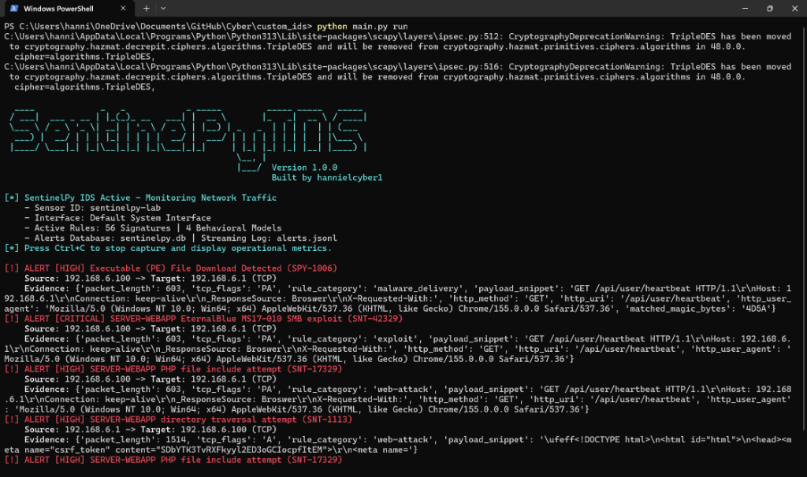
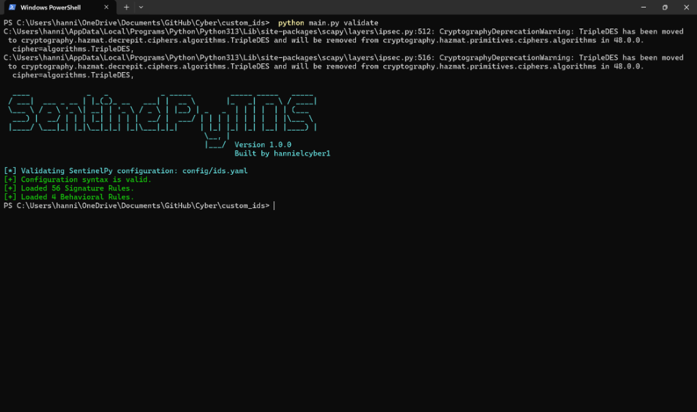
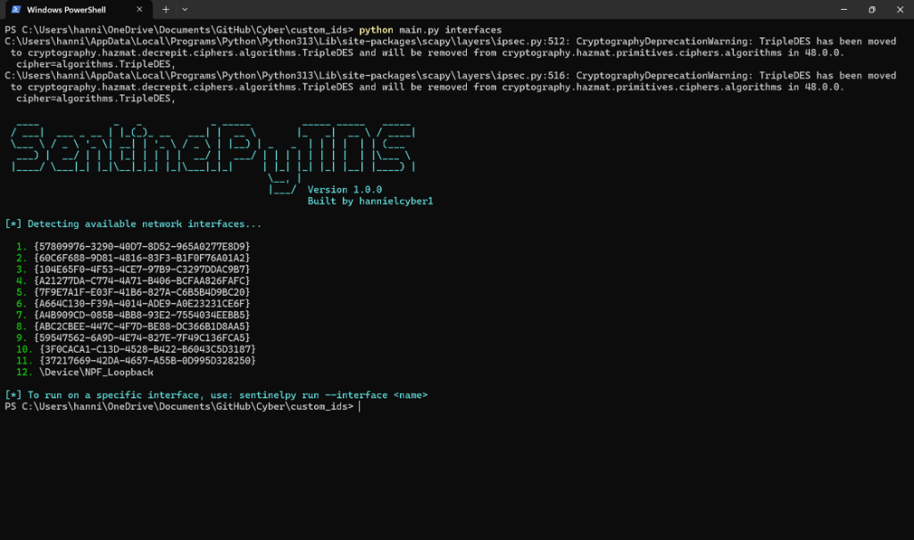

# SentinelPy IDS

> **Author**: Built by **hannielcyber1**

**SentinelPy IDS** is a modular Network Intrusion Detection System (NIDS) prototype built in Python and Scapy, designed for cybersecurity portfolio demonstration, home SOC labs, and defensive security engineering.

It combines the **signature-based pattern matching of Snort** with the **protocol-aware behavioral flow monitoring of Suricata**, providing structured alert feeds in SQLite and JSON Lines (EVE-compatible) format.

---

## 🏛️ High-Level Architecture

```
                       +----------------------------------+
                       |   Packet Capture / PCAP Replay   |
                       +-----------------+----------------+
                                         |
                                         v
                       +----------------------------------+
                       |    Packet Normalization Layer    |
                       |      (Canonical Record/Flow)     |
                       +--------+----------------+--------+
                                |                |
                                v                v
            +-----------------------+        +-----------------------+
            |   Signature Engine    |        |   Behavior Engine     |
            | (Snort-style indexing)|        | (Rolling Time Windows)|
            +-----------+-----------+        +-----------+-----------+
                        |                                |
                        +----------------+---------------+
                                         |
                                         v
                       +----------------------------------+
                       |    Alert Correlation & Dedup     |
                       |       (Severity & Cooldown)      |
                       +-----------------+----------------+
                                         |
         +-------------------------------+-------------------------------+
         |                               |                               |
         v                               v                               v
+-----------------+             +-----------------+             +-----------------+
| Colored Console |             | SQLite Database |             |   EVE JSONL &   |
|   Terminal UI   |             | (sentinelpy.db) |             |   Email Alert   |
+-----------------+             +-----------------+             +-----------------+
```

---

## 📸 In Action (Terminal Previews)

| Live Real-Time Detection & Prevention |
|:---:|
|  |

| Rule Validation (56 Signatures + 4 Behavioral) | Available Interface Discovery |
|:---:|:---:|
|  |  |

---

## 🚀 Key Capabilities

1. **Dual Detection Engines**:
   - **Signature Detection & Deep Packet Inspection (DPI)**: Evaluates packet headers, TCP flags, ports, payload regex (PCRE), binary magic byte signatures (e.g. `4D5A` Windows executables), and unencrypted TLS ClientHello Server Name Indication (SNI) on encrypted traffic.
   - **Behavioral Anomaly Detection**: Tracks rolling time-window counters for TCP port scans, ICMP ping sweeps, ARP floods, and SSH connection bursts.
2. **Deterministic PCAP Replay**:
   - Test and validate rules offline without requiring live network privileges.
3. **Structured Storage & SIEM Export**:
   - Saves queryable events in **SQLite (`sentinelpy.db`)**.
   - Streams events in **JSON Lines (`alerts.jsonl`)** suitable for Wazuh, Splunk, or Elastic Stack ingestion.
4. **Active Email Notification**:
   - Sends real-time email alerts via SMTP/TLS with intelligent cooldown suppression.
5. **Operational Health & Latency Metrics**:
   - Tracks packet throughput, processing latency (ms/pkt), active flows, and invalid packet drops.
6. **Active IPS Defense (Automated Firewall Drops)**:
   - Evaluates incoming alerts and drops malicious attacker traffic in real time via the native OS firewall (`netsh advfirewall` on Windows / `iptables` on Linux) with automatic time-based block expiration.
7. **Network File Extraction Engine**:
   - Performs TCP stream reassembly to extract transmitted files (PDF, PE/EXE, ZIP, Office OLE, images, ELF binaries) to disk for malware sandboxing and forensics.
8. **Stateful Flowbits Chaining**:
   - Links multi-stage cyber attacks across disparate packets in the same flow, enabling detection of phased exploit chains while suppressing false positives on isolated commands.
9. **Encrypted Traffic Analysis & Threat Intelligence**:
   - JA3 TLS client fingerprinting, HTTP protocol dissection, and O(1) IP reputation lookup against active abuse.ch Feodo Tracker feeds.

---

## 📦 Installation & Setup

### 1. Requirements
- Python 3.10+
- [Npcap](https://npcap.com/) (on Windows, for live packet capture)

### 2. Install Dependencies
```bash
pip install -r requirements.txt
```

### 3. Configure Email Alerts (Optional)
Edit `config/ids.yaml` to update your notification settings:
```yaml
email_alerts:
  enabled: true
  smtp_server: "smtp.gmail.com"
  smtp_port: 587
  sender_email: "your_email@gmail.com"
  sender_password: "your_app_password"
  admin_email: "admin@example.com"
  cooldown_seconds: 60
```

---

## 💻 Command Line Interface (CLI)

SentinelPy provides an intuitive CLI for all operational tasks:

### 1. Validate Rules and Configuration
Validates syntax, schemas, and verifies there are no duplicate rule IDs:
```bash
python main.py validate
```


### 2. List Network Interfaces
Shows available network interfaces for live capture:
```bash
python main.py interfaces
```


### 3. Replay Offline PCAP Captures
Replay a packet capture to test detection rules deterministically:
```bash
python main.py replay --pcap tests/pcaps/tcp_port_scan.pcap
```

### 4. Monitor Live Network Traffic
Start real-time monitoring (run with Administrative / Root privileges):
```bash
python main.py run
```
*(Or specify an interface: `python main.py run --interface eth0`)*


### 5. View Recent Historical Alerts
Query alerts stored in the SQLite database:
```bash
python main.py alerts --limit 20
```

### 6. Import Snort Community Rules
Convert native Snort `.rules` files into SentinelPy YAML:
```bash
python main.py import-snort --rules path/to/community.rules
```

### 7. Threat Intel Blocklist Update
Download and index the latest malicious C2 / botnet IPs:
```bash
python main.py update-blocklist
```

### 8. Active IPS Management (Firewall Drops)
Monitor and manage automatic firewall blocking of threat actors:
```bash
# List all active firewall blocks
python main.py ips-list

# Manually unblock an IP
python main.py ips-unblock --ip 198.51.100.22

# Flush all active firewall rules
python main.py ips-clear
```

### 9. View Engine Health & Status
```bash
python main.py status
```

---

## 📜 Rule Formats

Rules are stored in human-readable YAML format.

### Signature Rule (`rules/signatures/network.yaml`)
```yaml
# Deep Packet Inspection: SQL Injection Regex
- id: SPY-1007
  name: SQL Injection Attack Pattern
  severity: critical
  match:
    protocol: tcp
    ports: [80, 443, 8080]
    regex: "(?i)(union\\s+select|select.*from|or\\s+1=1|--\\s*$)"

# Deep Packet Inspection: Malware Executable Download (Binary Magic Bytes)
- id: SPY-1006
  name: Executable (PE) File Download Detected
  severity: high
  match:
    protocol: tcp
    ports: [80, 8080]
    magic_bytes: "4D5A" # 'MZ' header for DOS/Windows PE executables

# Deep Packet Inspection: Encrypted Traffic TLS SNI Extraction
- id: SPY-1008
  name: Suspicious C2 Domain in TLS Handshake (SNI)
  severity: high
  match:
    protocol: tcp
    destination_port: 443
    tls_sni:
      - "evil-c2-server.com"
      - "tor2web"
```

### Behavioral Anomaly Rule (`rules/behavioral/port_scan.yaml`)
```yaml
- id: SPY-B1001
  name: Potential TCP Port Scan
  enabled: true
  category: reconnaissance
  severity: medium
  detector: unique_destination_ports
  scope:
    source: source_ip
    destination: destination_ip
    protocol: tcp
  window_seconds: 10
  threshold:
    minimum_unique_ports: 15
  description: >
    A source contacted many distinct TCP destination ports within a short time window.
  tags:
    - reconnaissance
    - port_scan
```

---

## 🧪 Automated Testing

Generate synthetic test PCAPs and run the automated test suite with `pytest`:

```bash
# Generate test PCAPs
python tests/generate_test_pcaps.py

# Run all unit and integration tests
pytest -v
```

---

## 🛡️ Target SOC Architecture

In an enterprise SOC lab, SentinelPy IDS acts as the edge sensor:
1. **Network Tap / Mirror Port** $\rightarrow$ SentinelPy IDS
2. **Alert Outputs**:
   - `alerts.jsonl` $\rightarrow$ Ingested into **Wazuh Agent / Splunk Forwarder**
   - `sentinelpy.db` $\rightarrow$ Queryable via SOC incident investigation dashboards
   - **SMTP Dispatch** $\rightarrow$ High-priority on-call notification
